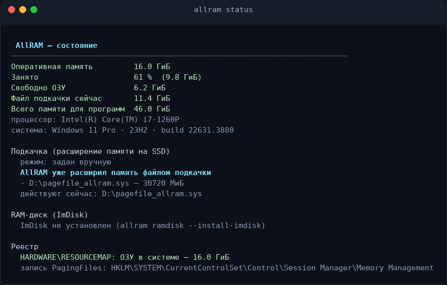
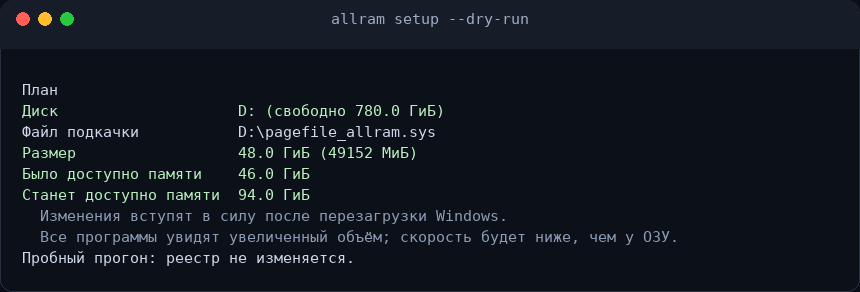
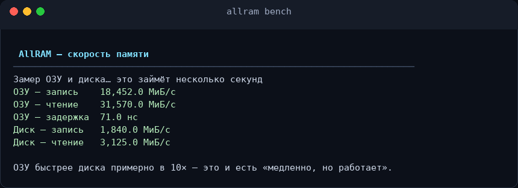
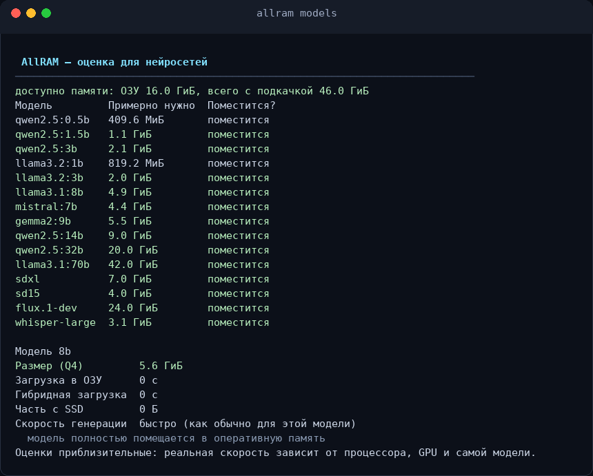

<p align="center">
  
</p>

<h1 align="center">AllRAM</h1>

<p align="center">
  <b>Используйте свободное место SSD как дополнительную оперативную память Windows.</b><br>
  Терминальная утилита без графического интерфейса: один <code>allram.exe</code>, без зависимостей.<br>
  Все программы видят больше памяти — но работают с этим объёмом медленнее, чем с настоящей ОЗУ.
</p>

<p align="center">
  <a href="../../releases/latest"></a>
  
  
  
  
</p>

<p align="center">
  
</p>

> На снимках — типовой ноутбук (16 ГиБ ОЗУ, расширение на D: 30 ГиБ).
> Значения подставлены для наглядности: на сервере без Windows подкачки нет.

| План расширения | Скорость ОЗУ против SSD |
| --- | --- |
|  |  |

| Нейросети: что поместится |
| --- |
|  |

---

## Честно, без обмана

Физический объём ОЗУ Windows определяет при загрузке по данным BIOS/UEFI,
и «дописать» его в реестр нельзя: значение в
`HKLM\HARDWARE\RESOURCEMAP\System Resources\Physical Memory` — это снимок для
отображения, оно ни на что не влияет. Ни одна программа не может сделать из
SSD настоящую оперативную память — она просто в разы медленнее.

Поэтому AllRAM делает то, что **действительно работает** и что Windows
поддерживает официально:

1. **Расширение памяти файлом подкачки.** Windows держит в файле подкачки
   «продолжение» оперативной памяти. Сумма «ОЗУ + подкачка» (`commit limit`) —
   это тот объём, который видят все программы, включая нейросети. AllRAM создаёт
   файл подкачки на выбранном SSD, выставляет размер и **сам прописывает его в
   реестр**, после чего настройка переживает перезагрузку.
2. **Режим RAM-диска.** Свободный драйвер [ImDisk](https://github.com/LTRData/ImDisk)
   превращает часть физической ОЗУ в очень быстрый диск для кэшей и временных
   файлов. AllRAM умеет скачать и установить его сам.

Итог: программы получают больше памяти, нейросети запускаются и работают,
но быстрее, чем на голом SSD, они не станут. `allram bench` показывает разницу
в развлечение и для понимания.

## Релиз 1.0.0

- [`allram.exe`](../../releases/latest/download/allram.exe) — один файл, 8.8 МБ, без Python и DLL.
- [`allram-win64.zip`](../../releases/latest/download/allram-win64.zip) — exe + README + контрольная сумма.
- [`SHA256SUMS.txt`](../../releases/latest/download/SHA256SUMS.txt) — контрольная сумма; сверьте её с `certutil -hashfile allram.exe SHA256`.

Собран на Windows 11 в GitHub Actions, тесты прогоняются перед публикацией.
Терминал, никакого GUI. Полный текстовый лог — в [`docs/demo.txt`](docs/demo.txt).

## Установка

1. Скачайте `allram.exe` со страницы [Releases](../../releases/latest)
   (или `allram-win64.zip`).
2. Запустите **от имени администратора** — иначе Windows не даст менять подкачку
   и создавать RAM-диск.
3. Следуйте меню или сразу выполните:

```bat
allram auto --apply
```

4. Перезагрузите компьютер. После перезагрузки Windows покажет увеличенный объём
   памяти с учётом нового файла подкачки.

Проверить контрольную сумму:

```bat
certutil -hashfile allram.exe SHA256
```

и сравните с `SHA256SUMS.txt` из релиза.

### Установка для разработчиков (без exe)

```bash
git clone https://github.com/1xcoding/allram.git
cd allram
python -m pip install -e .
allram --help
# или без установки:
python -m allram --help
```

Требуется Python 3.9+ и ничего кроме стандартной библиотеки.

## Быстрый старт

| Задача | Команда |
| --- | --- |
| Что с памятью сейчас | `allram status` |
| Расширить память автоматически | `allram auto --apply` |
| Свой диск и размер | `allram setup -d D -s 64G --apply` |
| Только посмотреть план | `allram setup -d D -s 64G --dry-run` |
| Вернуть как было | `allram revert` |
| Сравнить ОЗУ и SSD | `allram bench` |
| Что поместится из нейросетей | `allram models --model 8b` |
| RAM-диск на 4 ГиБ | `allram ramdisk -l R -s 4G` |
| Установить ImDisk | `allram ramdisk --install-imdisk` |
| Следить за памятью | `allram watch` |
| Как это работает | `allram explain` |
| Интерактивное меню | `allram` |

## Команды

```
allram [--json] [--no-color] <команда> [параметры]

status      состояние памяти, подкачки и RAM-дисков
setup       настройка файла подкачки: -d D -s 64G [--apply|--dry-run]
auto        автоподбор по профилю: --preset ai|browser|games|max|ramdisk [--apply]
revert      восстановить прежние настройки подкачки
ramdisk     RAM-диск ImDisk: -l R -s 8G [--temp] [--remove R] [--install-imdisk]
bench       замер скорости ОЗУ и диска: [-d D] [--ram-mib 64] [--disk-mib 32]
models      оценка нейросетей: [--model "llama3.1:8b" | --model 13b]
watch       наблюдение: [--interval 10] [--threshold 90] [--once] [--json]
recommend   рекомендации для этого компьютера
presets     список профилей
settings    настройки AllRAM: [--autostart] [--default-drive D] [--default-size 64G]
history     журнал операций
install     автозапуск наблюдателя и метка в реестре
uninstall   удалить автозапуск [--restore-pagefile]
explain     подробное объяснение принципа работы
backup      экспорт конфигурации и журнала в JSON
```

Все команды с `--json` печатают машинно-читаемый результат и подходят для
скриптов. `allram status --threshold 90` возвращает код `2`, если память занята
сильнее порога.

## Что именно меняется в системе

AllRAM не устанавливает службы и не патчит ядро. Он пишет только то, что Windows
и так умеет:

| Что | Где | Зачем |
| --- | --- | --- |
| `PagingFiles` | `HKLM\SYSTEM\CurrentControlSet\Control\Session Manager\Memory Management` | список файлов подкачки (наш: `D:\pagefile_allram.sys`) |
| `AutomaticManagedPagefile` | там же | отключает «автоматический» режим, чтобы размер сохранялся |
| `Run\AllRAM` | `HKCU\Software\Microsoft\Windows\CurrentVersion\Run` | автозапуск наблюдателя (`install`) |
| `last_*`, `version` | `HKCU\Software\AllRAM` | журнал последней операции |
| Настройки RAM-диска | `HKLM\SYSTEM\CurrentControlSet\Services\ImDisk*` | пишет сам драйвер ImDisk при `-P` |

Перед первым изменением подкачки AllRAM сохраняет исходные значения в
`%ProgramData%\AllRAM\backup.json` (или `%LOCALAPPDATA%\AllRAM\` без прав
администратора). `allram revert` возвращает их обратно.

**Удаление:** `allram uninstall --restore-pagefile`, затем удалите `allram.exe`.
Данные AllRAM лежат в `%ProgramData%\AllRAM` (конфиг, журнал, бэкапы, логи) —
удалять их не обязательно, но можно вручную.

## Нейросети: чего ожидать

`allram models` оценивает, поместится ли модель в доступную память:

| Модель (Q4) | Нужно примерно | 8 ГиБ ОЗУ | 16 ГиБ ОЗУ | 32 ГиБ ОЗУ |
| --- | --- | --- | --- | --- |
| Llama 3.2 3B | 2.0 ГиБ | ✅ | ✅ | ✅ |
| Mistral 7B | 4.4 ГиБ | ⚠️ с подкачкой | ✅ | ✅ |
| Llama 3.1 8B | 4.9 ГиБ | ⚠️ с подкачкой | ✅ | ✅ |
| Qwen 2.5 14B | 9.0 ГиБ | ❌ | ⚠️ с подкачкой | ✅ |
| Qwen 2.5 32B | 20 ГиБ | ❌ | ❌ | ⚠️ с подкачкой |

«⚠️ с подкачкой» — модель запустится, но часть слоёв будет читаться с SSD:
загрузка дольше, генерация медленнее. Для чата это терпимо, для обучения — нет.

Практические советы:

- `llama.cpp`/`Ollama` умеют держать модель в памяти через memory-mapped files —
  именно этот сценарий расширение памяти делает возможным.
- Для Stable Diffusion и Whisper выгоднее профиль `ai` и кэш на быстром SSD.
- Оставляйте на системном диске не меньше 10–15 % свободного места: переполненный
  SSD пишет медленнее и живёт меньше.

## Требования

- Windows 10/11 x64. Теоретически работает и на Windows 8.1/Server, но проверено
  на 10/11.
- Права администратора для изменения подкачки и RAM-диска.
- Перезагрузка после изменения настроек подкачки.
- Для RAM-диска — драйвер ImDisk (AllRAM скачает его с `ltr-data.se` и
  установит, либо поставьте вручную).

## Сборка exe

```bash
python -m pip install -r requirements-dev.txt
python scripts/build.py --clean      # Windows: dist/allram.exe + SHA256SUMS.txt
python -m pytest -q                  # 59 тестов
```

Сборка автоматизирована: `.github/workflows/release.yml` собирает исполняемый
файл на `windows-latest`, прогоняет тесты, прикладывает артефакт и по тегу `v*`
(или ручному запуску) публикует релиз с `allram.exe`, `allram-win64.zip` и
`SHA256SUMS.txt`.

В песочнице разработки Linux без `libpython` собрать исполняемый файл нельзя —
используйте Windows или GitHub Actions, скрипт сам объяснит это понятным текстом.

## Ограничения и безопасность

- Расширение памяти **не ускоряет** программы: это обмен «объём вместо скорости».
- Файл подкачки на SSD создаёт дополнительную нагрузку на диск; при частом
  использовании это сокращает ресурс записи. Не делайте расширение больше, чем
  реально нужно.
- Не отключайте подкачку полностью: многие программы и сама Windows ожидают её
  наличия.
- RAM-диск теряет данные при выключении — храните на нём только кэш и временные файлы.
- AllRAM ничего не скачивает без явной команды (`--install-imdisk`) и не
  отправляет данные наружу.

## Структура проекта

```
allram/            пакет: cli, pagefile, ramdisk, registry, memory, benchmark, watch
allram_main.py     точка входа для PyInstaller
scripts/           build.py (сборка exe), make_icon.py (иконка), demo.sh
tests/             59 тестов (pytest)
docs/              demo.txt, demo.png, release-notes.md
.github/workflows/ CI: тесты + сборка exe + релиз
```

## Лицензия

MIT — см. [LICENSE](LICENSE). ImDisk распространяется под собственной свободной
лицензией; AllRAM только вызывает его исполняемый файл.
